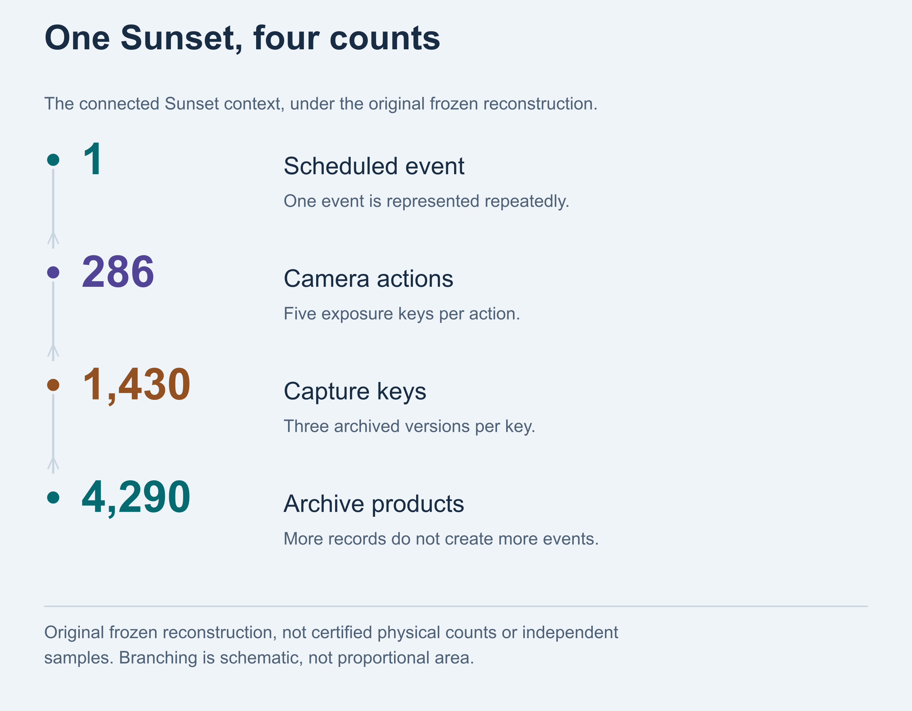
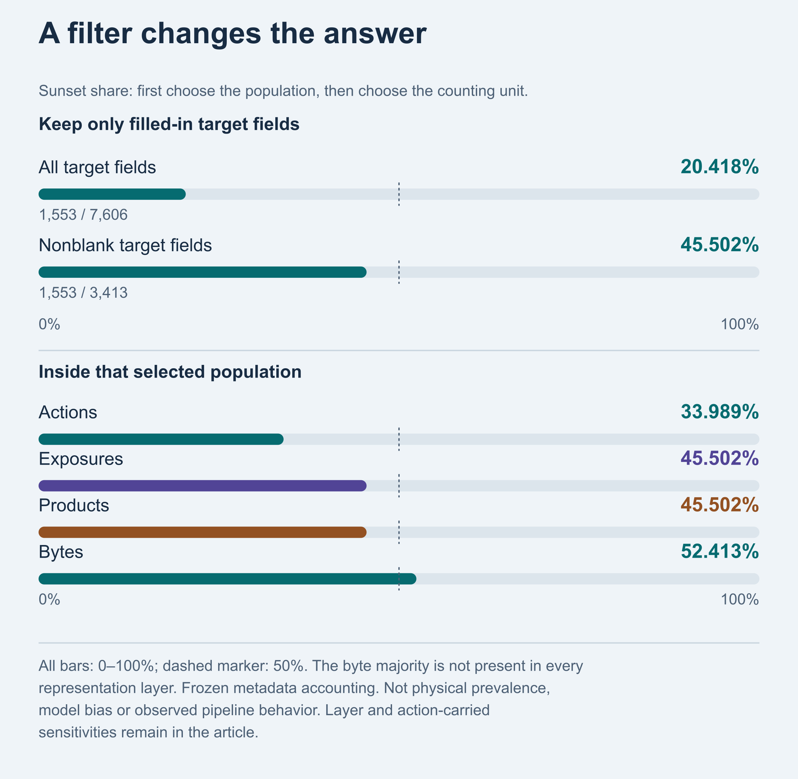
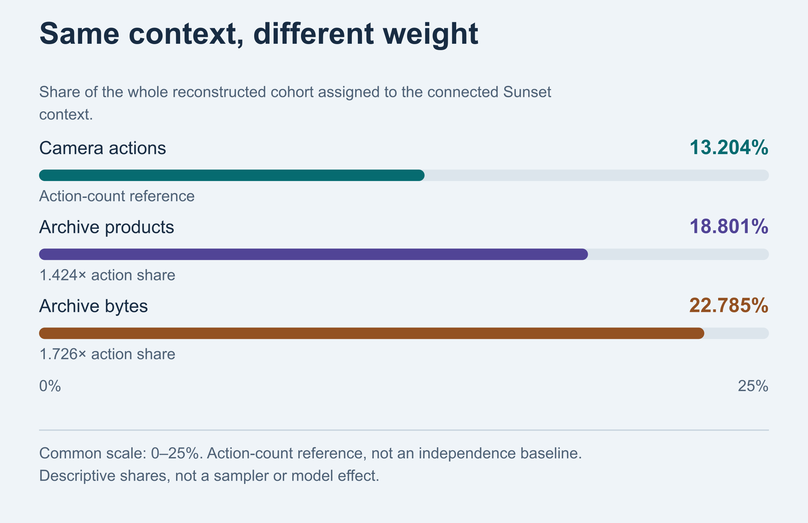
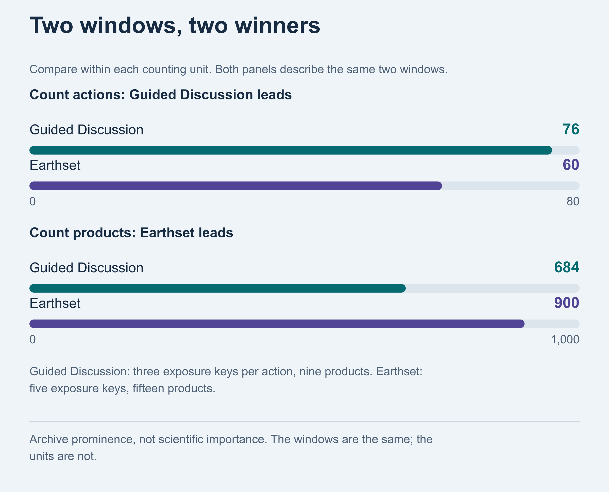
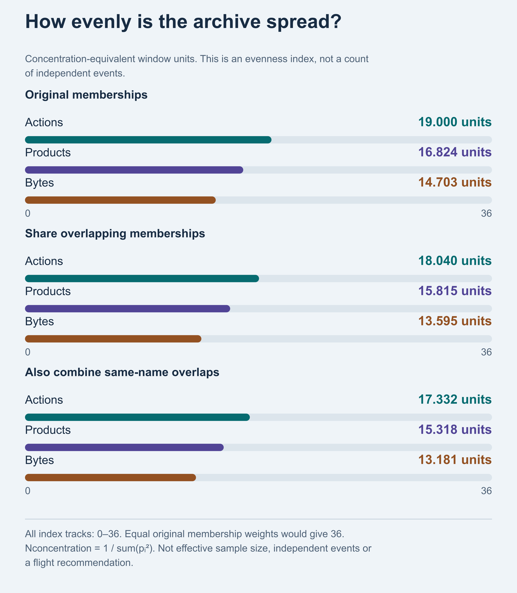
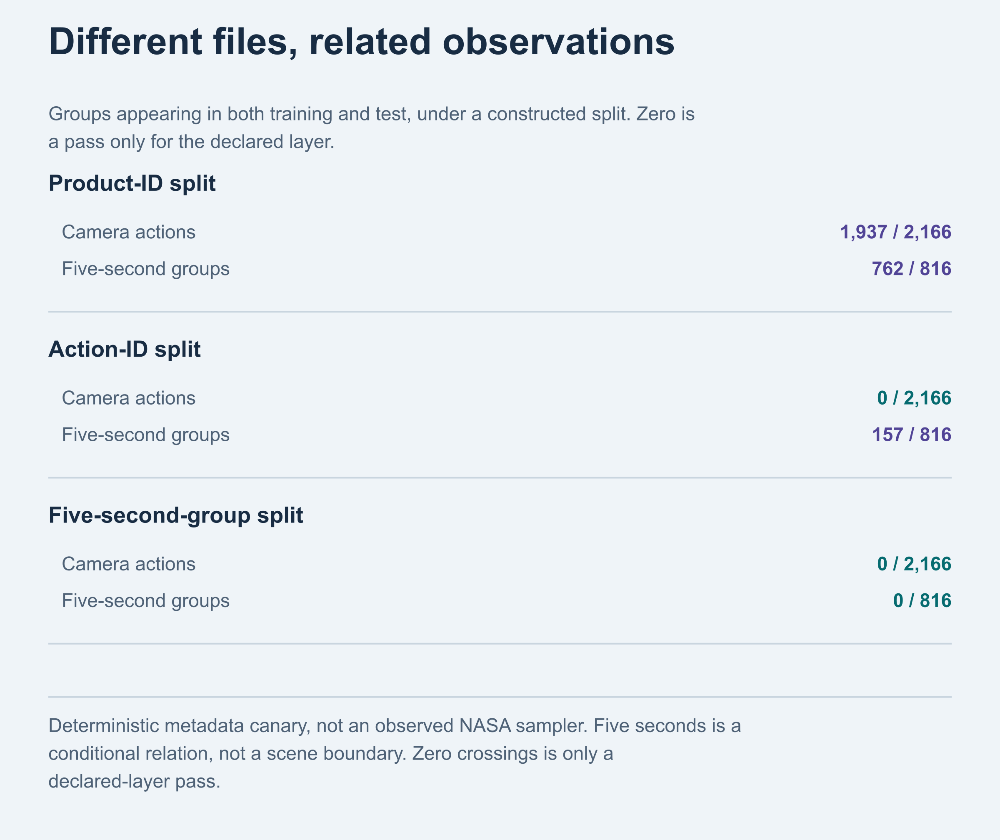
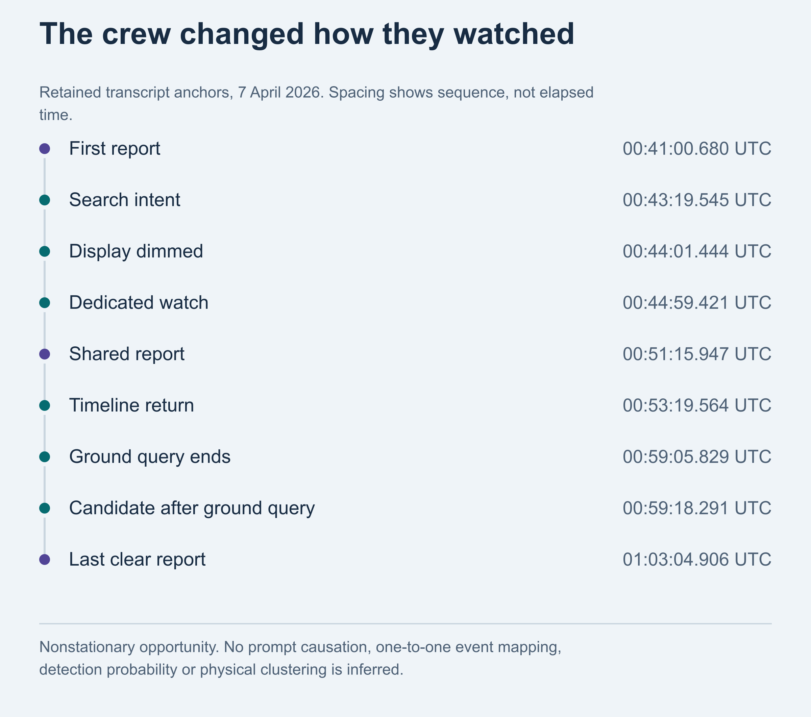
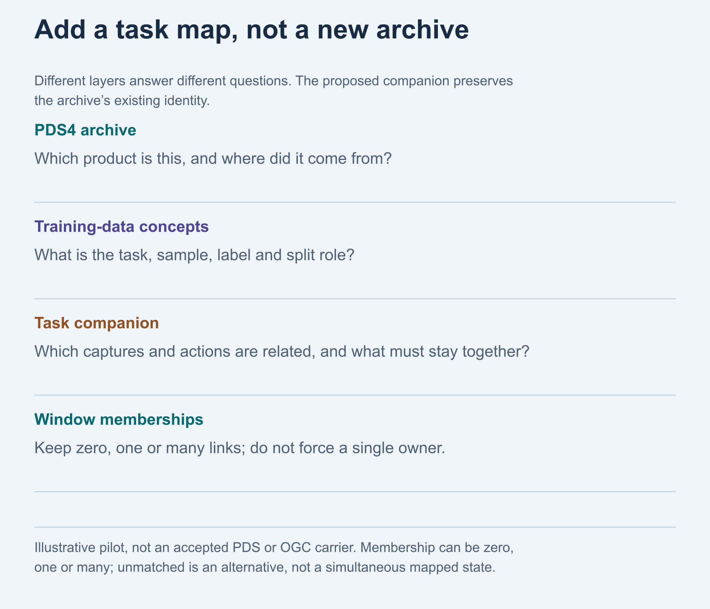
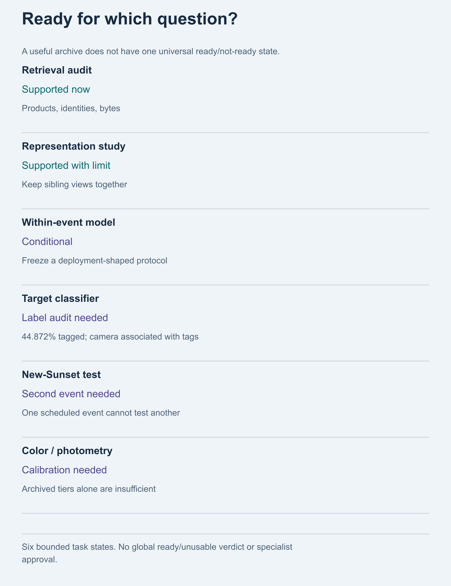

# 4,290 Data Products, One Sunset

*NASA opened more than 800 gigabytes of Artemis II data. Before asking what it reveals, ask what counts as an observation.*

**4,290 rows. One scheduled Sunset.**

[NASA released](https://www.nasa.gov/blogs/artemis/2026/10/07/nasa-releases-artemis-ii-lunar-science-data-images/) more than 800 gigabytes of imagery, video, astronaut audio, transcripts, annotations, and mission documents. [WIRED described it](https://www.wired.com/story/nasa-just-made-nearly-1-tb-of-artemis-ii-data-available-to-the-public/) as nearly a terabyte made public. The release includes more than 11,000 full-resolution images and videos and 8.5 hours of spoken observations.

This scientific gift invites a mistake: treating every file as a fresh piece of evidence.

Imagine testing an AI on the lunar Sunset. How many examples does the archive give you?

4,290 archive products? 1,430 exposures? 286 camera actions? One scheduled event?

Each count answers a different question. Files matter for download size. New observations matter when testing a model on something it has not seen. More files do not necessarily supply more of that second thing.

Counts are exact for the frozen reconstruction, not independently validated physical counts. The question chooses the unit.

The archive is also a hidden experimental design. Before a model sees a pixel, the researcher has to make four choices explicit:

1. **Relationship:** keep records from the same observation connected.
2. **Selection:** say which records entered the analysis, and which were left out.
3. **Weighting:** say whether an action, exposure, file or byte gets a vote.
4. **Detection:** show what the observer or camera could actually register.

These choices determine what a model score, an event count, or “we found nothing” can mean. The archive does not make those decisions for every future task.

One observing window leads by camera actions, 76 to 60, then loses by files, 684 to 900. In a constructed split, all 4,511 held-out products remain action-linked to training. Neither describes a NASA model. Both show why counting and splitting rules deserve scrutiny before modeling.

## Relationship: how one event becomes 4,290 products

An archive **product** is a stored file. An **exposure** records a frame. A reconstructed **camera action** groups the exposure bracket, a short sequence taken at different settings. Here, each exposure has three archived representations. Those useful versions are related, not separate observations.

For the connected Sunset context, that structure gives:

> **1 connected context × 286 camera actions × 5 exposures per action × 3 products per exposure = 4,290 archive products**

One observed context can therefore produce thousands of products without becoming thousands of independent events.

*Figure 1. Four counts under the original frozen reconstruction. They are not interchangeable sample sizes. Figures 1–6 and 9 retain that original cohort; the conditional comparison below is separate.*

The narrow eight-minute block in NASA’s lunar targeting plan contains 2,535 products, 845 exposures, and 169 camera actions. The transcript records the Sun’s disappearance before that window and significant glow after it. Expand the boundary conservatively to include that connected context and the footprint becomes 4,290 products, 1,430 exposures, and 286 actions.

The event count remains one.

This boundary is not an oracle for the exact visual event. Schedule, speech and pixels differ. Context adds files, not independence.

## Our reconstruction needed the same scrutiny

The same records changed groups when their order changed. Reversing the input to our unchanged finder turned 2,166 reconstructed sequences and 7,606 keys into 2,134 sequences and 7,502 keys. Original receipts remain exact for their source order and algorithm, not an order-invariant physical census. This is our limitation, not evidence about NASA’s pipeline.

A separate candidate accounts for every original sequence, gives identical output across eight tested input orders, and withholds nine identity-alternative families. One contains an original five-frame sequence. Matching metadata alone does not certify physical identity: no representative was chosen and the candidate was not adopted.

I sent JPL a narrow question: did `art002e009301` and `art002e015991` represent the same exposure, and could the public image be traced to an archived NEF?

JPL's 13 October reply reported the science/archive teams' confirmation: identical images, originally `019A0860.NEF`, with a source locator. They suggested an early public-release record survived alongside a later batch and would investigate documentation or mitigation.

Both catalogue IDs remain in the evidence trail. Only `art002e015991` entered the original analysis cohort, so no original totals were reduced. Checksums and JPEG processing remain unanswered.

That exchange resolved one relationship, not the whole reconstruction.

Proof: one-action withholding

Conditionally withhold the five-frame camera action containing `art002e015991`: five capture keys and fifteen product rows. Freeze surviving fields, split assignments, grouping keys and schedule intervals.

| Quantity | Original | One-action withheld |
| --- | ---: | ---: |
| Product rows | 22,818 | 22,803 |
| Test products: capture-linked + action-only-linked + isolated | 4,307 + 204 + 0 | 4,305 + 204 + 0 |
| Sunset share of selected actions | 33.989% | 34.026% |
| Sunset share of combined selected bytes | 52.413% | 52.545% |

All eight named conclusion tests survive this one treatment, not eight independent replications or every identity uncertainty. Physical identity remains unresolved across the full reconstruction; one steward-confirmed pair does not settle it. Figures and main quantities retain the original cohort.

## Selection: a blank label is not a negative example

A Sunset target tag is not an event identifier. Tag-based counts below and the plan/transcript-defined context above select different records.

In the original frozen cohort of 7,606 source exposures, 3,413 have a target tag and 4,193 do not. “Source exposures” here counts native capture keys, not independently certified physical exposures. That is 44.872 percent coverage.

The blanks are concentrated in particular activities. They are not a random sprinkling of empty cells, so throwing them away changes which parts of the mission the analysis represents.

Proof: missingness and possible completions

Across 45 activity values, 17 have no target-tag coverage, eight have complete coverage, and 20 are partial. An in-sample activity-majority lookup predicts tag presence at 87.484 percent, versus 55.128 percent for the global-majority baseline. This diagnoses activity-linked curation, not a deployable model.

Hold recorded fields fixed and let blanks take Sunset or another value: completed Sunset field share can range from 20.418 to 75.546 percent. This is a possibility range, not a confidence interval or image-content prevalence. Sampling label quality and resolving fields are different jobs.

Among records with a target tag, Sunset is prominent: 1,553 exposures, or 45.502 percent of all tagged exposures. But an empty target field does not mean “not Sunset.” Looking only at tagged records cannot tell us how common Sunset is across the archive without stronger assumptions.

Even camera identity is associated with which tags were assigned. Acquisition, operations and curation could contribute. Before calling a classifier successful at recognizing a feature, compare it with a camera-only metadata model and audit how the labels were produced.

The [native Sunset request](https://pds-geosciences.wustl.edu/artemis2/urn-nasa-pds-artemis2_mission/document/artemis2_outgoing_target_request.json) includes corona, possible horizon glow, and limb observations. Before scoring images, a specialist must define the depicted feature and adequate reference evidence. An observing objective is not an image-level answer key.

## Selection and weighting can compound

A routine query keeps only records whose target field is filled in: `target_id IS NOT NULL AND target_id <> ''`. Nothing has been relabeled. The query has simply removed the blanks.

Sunset occupies 1,553 of all 7,606 source-exposure target fields, or 20.418 percent. The same Sunset rows become 45.502 percent after the query retains only 3,413 nonblank fields. The denominator changed by 2.229 times.

Now change how those selected records get a vote. Count actions and Sunset is about a third. Count attached bytes and it passes half.

The exact shares are 311 of 915 camera actions, or 33.989 percent; 45.502 percent of tagged exposures and their products; and 52.413 percent of combined bytes: 409,399,017,151 of 781,104,206,358 bytes. That majority does not hold in every representation layer.

*Figure 2. A common selection predicate changes the population; the counting unit then changes the influence inside it.*

Proof: representation and activity sensitivities

Carrying each selected action's tag across its blank exposures leaves Sunset at 51.495 percent of selected bytes. This is an accounting sensitivity, not new ground truth.

The majority is representation-sensitive: 49.188 percent of tagged source-representation bytes, 52.720 percent of raw-representation bytes, and 52.734 percent of processed-representation bytes. It applies to the combined selected byte mass, not every layer.

Its main source is also visible. The fully tagged `24_Sunset` activity supplies 1,294 of the 1,553 Sunset-tagged exposures. Outside that activity, Sunset is 12.223 percent of tagged exposures and 21.554 percent of tagged bytes. That is an attribution check, not a better target population.

Across all 23 nonblank target-tag values, the concentration-equivalent count contracts from 5.064 tag values under fractional action weighting to 3.823 under exposure or product weighting and 3.191 under byte weighting. Sunset ranks first under every unit. These are concentration indices, not physical-class counts.

The same archive can tell these different descriptive stories because the selected population and voting rule differ. No sampler or model was observed. This is accounting for curated tags, not measuring what the images physically show.

## Weighting: every product is a vote

If every file has an equal chance of being sampled, a three-exposure action gets nine tickets; a five-exposure action gets fifteen. The longer bracket gets more chances to enter the analysis.

> **15 ÷ 9 = 1.67 times the product-level weight**

The three representations multiply both equally. The unequal influence comes from the number of exposures per action, not from preserving useful versions of each exposure.

The connected Sunset context makes up 13.204 percent of the reconstructed camera actions, but 18.801 percent of the archive products and 22.785 percent of the bytes.

> **Product-weight multiplier = 18.801% ÷ 13.204% = 1.424×**
>
> **Byte-weight multiplier = 22.785% ÷ 13.204% = 1.726×**

*Figure 3. The observation did not change. The denominator did.*

No model was tested. Archive structure alone assigns unequal influence under uniform product weighting; this does not prove model bias.

## Change the noun, change the winner

One Guided Discussion window contains 76 camera actions and 684 products. An Earthset window has fewer actions, 60, but more products: 900.

Count actions and Guided Discussion is larger. Count products and Earthset wins.

*Figure 4. A real rank reversal caused by changing the counting unit.*

Proof: rank reversals and bytes per action

Among 621 strictly ordered action/product window pairs, 38 reverse rank, all across different products-per-action rates. Among 222 comparable pairs with the same product rate, none reverses. Of the 38, 35 persist under byte totals, three disappear, and file-size variation creates 24 additional byte-only reversals. The total rises to 59.

> **bytes per action = exposures per action × products per exposure × mean bytes per product**

The winner changes because an Earthset action has more products attached to it. “Dataset size” combines the exposure protocol, archived versions and file sizes. It ranks archive prominence, not scientific importance.

## A majority is not a margin of safety

A separate hypothetical reassignment of the 48 highest-weight recorded Sunset fields to another nonblank target erases the selected-byte majority. These are not detected errors. No source tag changes.

Proof: hypothetical 48-field majority boundary

Freeze the nonblank query, capture keys, three representations and byte weights. Hypothetically reassign the **48 largest Sunset field weights** to another nonblank target: 52.412855% falls to 49.980167%. The best 47 leave 50.030744%. Exact predecessor checks prove the 48-field cardinality minimum under this individual-field model.

With recorded memberships fixed and blanks unconstrained, full-cohort combined-byte membership spans 25.189424%–77.129794%. These are marginal completion endpoints, not confidence intervals or a joint multiclass answer.

Perfectly resolving highest-weight blanks, at equal individual-field cost, still needs **3,747** resolutions for a worst-case width ≤5 percentage points. Exposure weighting needs 3,813: only 66 fewer. Actual retrieval, viewing and adjudication costs are unknown; unequal costs invalidate a general cost-optimality claim.

This asks how few strategically chosen fields could overturn one accounting claim, not how many fields are wrong. Worst-case reassignment is not random-error tolerance, an estimated error rate, rank reversal or image-content judgment.

A blank-only audit cannot validate recorded tags. Publish population, unit, source version, perturbation model and the majority-changing witness. Completion guarantees are not statistical sample sizes or a demand for backfilled metadata.

## Thirty-six windows, unequal influence

The same weighting choice affects the whole schedule. If a few windows supply much of the archive, a large file collection can still lean heavily on those few opportunities.

For 36 active planned windows, define each window’s share of the chosen weight as *pᵢ*. Then compute a concentration-equivalent count:

> **Nconcentration = 1 ÷ Σpᵢ²**

Think of this as an evenness score: how many equally weighted windows would have the same concentration? Equal weights would give 36. Action weights produce 19.000 equivalent windows; product weights, 16.824; byte weights, 14.703.

*Figure 5. The 36 scheduled memberships concentrate into roughly 19 action-weighted or 14.7 byte-weighted window units before overlap sensitivities.*

This concentration index is not an effective sample size, independent-event count or request to refly the mission. Plan names are lexical, not proof of comparable geometry or scientific replication.

It is a reason to check which observing opportunities dominate before claiming that a result transfers to another event. It does not tell us how many physically independent events occurred.

Proof: overlap and replication debt

Some actions map to multiple windows. Fractionalizing those memberships gives 18.040 action-equivalent, 15.815 product-equivalent, and 13.595 byte-equivalent windows while preserving the totals exactly. Collapsing four overlapping or touching same-name windows gives 17.332, 15.318, and 13.181.

Nineteen exact plan names appear across the 36 windows. Reaching two scheduled windows per exact name would require at least 12 additional windows; reaching three would require 27. This is not a flight recommendation or evidence that same-name windows constitute scientific replication.

## A clean split can still split the same observation

Suppose every product is independently assigned to an 80/20 train/test split. The training set is what the model learns from; the test set is meant to judge it on held-out material. The filenames can be different while related representations and exposure siblings from the same camera action land on both sides.

Proof: split mathematics and canary

For a parent group with *n* children and training probability *p*:

> **P(crossing) = 1 − pⁿ − (1 − p)ⁿ**

In this cohort, actions contribute nine or fifteen products. Independent product splitting gives 89.111 percent expected action crossing, or 1,930 of 2,166 groups. Grouping representations but independently splitting exposures still gives 52.911 percent.

A deterministic canary made this inspectable. Product-ID hashing fractured 1,937 of 2,166 camera actions. Action-ID hashing left zero action crossings, but 157 of 816 conditional five-second groups still crossed, placing 1,216 actions inside a crossed outer group. Five-second-group hashing left zero crossings at both declared layers.

*Figure 6. A split can pass one declared relationship and fail the next outer one.*

Protecting one layer of related records does not automatically protect the next. Keeping an action together still allows neighboring actions from the same short run to cross the split.

The expected calculation is a mathematical hazard model, not evidence of leakage in an existing Artemis II pipeline. The canary is a validator test, not an observed sampler. Five seconds is a conditional relation, not a discovered scene boundary.

Of 4,511 held-out products, 4,307 share an exact capture identity with training; the remaining 204 share a reconstructed complete camera action. Zero are isolated from training at the complete-action layer.

This complete structural classification does not establish pixel similarity or performance inflation. A “new example” needs a declared unit before its score can imply new-action or new-event generalization.

NASA and IBM’s lunar [SomBench](https://arxiv.org/abs/2609.13277) already keeps spatial parent zones intact across splits. The Mars [MCTED dataset](https://arxiv.org/abs/2509.08027) groups intersecting stereo footprints before partitioning. The field knows that spatial siblings must stay together. Artemis II shows the temporal and operational sibling problem: alternate representations, exposure brackets, shutter actions, short runs, and realized episodes.

## Detection: the observer changed after the first flash

The crew’s lunar-flash reports reveal the fourth function: detection. A camera can record continuously without being sensitive enough to see a particular signal. A person can spend time beside a window without watching under constant conditions.

After the first retained report, the crew explicitly decided to look for flashes. They addressed glare, dimmed a display and began dedicated watching while their eyes continued adapting to the dark. Later they returned to the science timeline. A ground query preceded a further report. The reports span changes in how the crew was observing, not one constant viewing state.

*Figure 7. The retained flash sequence crosses multiple transcript-evidenced observation states.*

Exact transcript times and intervals

The first retained report occurred at 00:41:00.680 UTC. Explicit intent to search for flashes came 138.865 seconds later. The crew then identified glare, dimmed a display, began dedicated watching, and described continuing dark adaptation. A shared report followed 376.526 seconds after dedicated watching began. At 00:53:19 they returned to the science timeline. Later, a ground query ended just 12.462 seconds before another report. The last clear report came 1,324.226 seconds after the first.

These are retained transcript anchors, not a complete event catalogue or a one-to-one assignment to the accepted flashes.

At the later crew conference, astronauts described intentional watching, adaptation resets at bright displays, a black shirt controlling window glare, and possible priming and correlation.

This does not diminish the reports. It means that an hour on the clock is not automatically an hour of comparable watching. Raw eclipse clock time is a composite, unsegmented human observation opportunity: it mixes changes in attention, glare and adaptation.

Five accepted events divided by an hour cannot become a calibrated human detection rate without knowing who was watching, under which conditions, how faint a signal they could see, and what they would miss. The transcript supports changing observation conditions. It does not estimate per-state detection probability, prove prompt causation, establish witness independence, map every report to a numbered event, or show physical clustering.

The camera record reinforces the same principle. A bounded 15-second video interval overlapping one report contains 900 frames at about 59.94 frames per second, yet the threshold-defined Moon footprint is only 10 by 9 pixels. A frozen screen found no qualifying pulse. In 1,458 clip-native synthetic injection trials, it recovered none through 12,000 requested integrated digital counts per frame and only 5.6 percent at the highest requested level. Those are uncalibrated transcoded-video units, not astronomical brightness.

The annotation's photo timestamp cannot certify ledger creation or bound all five events.

So the local null is non-exclusionary: finding no pulse in this test cannot rule out the reported flash. It does not show that a flash occurred in the clip or that the flight camera was incapable. The screen has not demonstrated the sensitivity needed to decide that question. NASA’s [preliminary lunar-science report](https://science.nasa.gov/feature/artemis-ii-preliminary-lunar-science-report/) already recommends calibrated, high-frame-rate, high-dynamic-range monitoring, window characterization, timestamped audio, and synchronized clocks. The extra step is to publish the detection receipt that connects those capabilities to each claim.

## NASA already has a family tree

The [PDS4 Data Provider’s Handbook](https://pds.nasa.gov/data/pds4/documents/document_pds4_standards/1.26.0.0/PDS4_DPH_1.26.0.pdf) describes a model-driven archive: unique identifiers and structured labels, source links, scientific review. Conformance is not scientific correctness.

Its [Machine Learning Analysis dictionary](https://pds-data-dictionaries.github.io/ldd-ml/user/user-guide.html) covers roles and evaluation; NASA’s [Planetary Data Ecosystem review](https://science.nasa.gov/wp-content/uploads/2023/05/PDEIRBFinalReport-1.pdf) and [response](https://science.nasa.gov/wp-content/uploads/2024/03/psd-pde-irb-response-v1-20240228.pdf) address analysis-ready products and machine-actionable links.

The Open Geospatial Consortium’s [TrainingDML-AI standard](https://www.ogc.org/standards/trainingdml-ai/) supplies sample, label, provenance and split-role concepts.

Artemis II’s [Open Science and Data Management Plan](https://pds-geosciences.wustl.edu/artemis2/urn-nasa-pds-artemis2_mission/document/artemis2_osdmp.pdf) anticipated acquisition, target, geometry and associated-file metadata. Its [Data User Guide](https://pds-geosciences.wustl.edu/artemis2/urn-nasa-pds-artemis2_mission/document/artemis2_data_user_guide.pdf) is candid: timeline-derived activities could be overridden; targets were manually assigned to a subset and may contain errors.

That mature archive practice changes the criticism. Provenance, calibration and grouped splitting are not new to NASA.

A task companion, a small file alongside the archive, declares **analytical dependence**: which records share a capture, action or episode, and which relationships the split must protect. It does not replace NASA’s archive or certify independence.

Those models operate at different levels. [PDS collection inventories](https://pds.nasa.gov/datastandards/documents/dd/current/PDS4_PDS_DD_1J00/webhelp/all/ch03s70.html) already enumerate member products. Equivalent relationships may exist in mission-specific products or workflows not inspected here. Membership is not independence.

The archive has a family tree. The analysis table can still forget it.

## The answer is not less data

Keep processed products, brackets and context. Declare the four functions on top of NASA’s archival relationships.

*Figure 8. PDS4 answers identity and lineage. TrainingDML-AI supplies sample, task, split-role, provenance, and quality concepts. A task companion declares claim-specific relationships and receipts.*

For the original cohort, two uncompressed CSV ledgers total 10,470,310 bytes, preserving product/capture/action and many-to-many window links without pixels. That is 0.000644 percent of its 1.625-terabyte footprint. Cheap storage does not mean cheap scientific curation.

Ten megabytes cannot guarantee independence. They can make the declared grouping rules inspectable before scoring.

## What NASA could publish next

Start with one bounded pilot for a frozen crew-camera task. Provider, node and task specialists produce a versioned relationship ledger, a reproducible split, and selection/weighting summaries from existing products. These make the declared counting and evaluation rules inspectable, without asserting physical independence. Detection is a separately owned feasibility stage for one frozen interval, not a camera-task pilot prerequisite.

For the separate detection stage, first inventory calibration, live-time, area, timing and window records. If they cannot support threshold-specific recovery, state the gap and withhold null or rate claims. Missing historical calibration cannot be reconstructed by adding metadata. A future instrument campaign is a separate specialist decision.

Together, these stages define four linked receipts:

- **Relationship:** a map of related records, with a test showing that protected groups stay together.
- **Selection:** a record of what entered the analysis, what was excluded, and how labels were assigned.
- **Weighting:** a comparison showing how the answer changes when actions, exposures, files or bytes get the vote.
- **Detection:** evidence of which signals could be recovered under the stated observing conditions.

A receipt is a compact, versioned record of the evidence and rules behind a claim. It makes the claim inspectable; it does not make the claim scientifically accepted.

Pilot specification: fields, failure rules and validation

| Receipt | Minimum contents | It should fail when |
| --- | --- | --- |
| **Relationship** | product, exposure, action, run, window or episode IDs; authority; membership basis; method version; review state; explicit unknowns | siblings cross a protected split, one-to-many links are flattened, or derived IDs appear as official truth |
| **Selection** | target population; exact inclusion predicate; label source; coverage and attrition by activity and camera; adjudication state; missingness categories; metadata-only baselines | blanks become negatives, tagged prevalence becomes archive prevalence, or a query hides what it removed |
| **Weighting** | prediction unit; estimand; matched-population action/exposure/product/byte weights; overlap policy; concentration table; conservation and sensitivity tables; per-group influence | a file count silently becomes an observation count, populations change between columns, or multiply assigned actions are double-counted |
| **Detection** | observed area and live time by state; calibration; threshold; synchronized timing; window effects; false-positive review; injection-recovery curve | a null or rate is published without demonstrated sensitivity at the claimed threshold |

Publish a reference splitter with a content-hashed record: input, algorithm, protected keys, seed, assignments, unknowns and crossing violations. Test order perturbations and preserve identity alternatives before accepting groups. Retain excluded rows, a camera-only baseline and a qualified label concept. Use matched populations, action-carried sensitivity and the smallest majority-changing perturbation with exact source-linked witnesses. Separate blank-completion objective and cost model from a probability audit. Measure detection recovery by brightness, duration, position, background and channel.

PDS’s [archiving process](https://pds.nasa.gov/home/proposers/archiving/) gives discipline nodes responsibility for archive design and dictionary changes. Its [supplemental metadata](https://pds.nasa.gov/datastandards/documents/dd/current/PDS4_PDS_DD_1J00/webhelp/all/ch03s52.html) and [source-product](https://pds.nasa.gov/datastandards/documents/dd/current/PDS4_PDS_DD_1J00/webhelp/all/ch03s111.html) carriers have distinct rules. The provider, node, and specialists should choose the carrier after the pilot. This is a proposed experiment, not NASA-accepted guidance.

Passing verifies exposed claim conditions, not labels, independence, representative sampling, calibration or model generalization. Report curation effort, specialist review time, update cost and unresolved cases. Keep the pilot experimental until an independent user reproduces versioned receipts and the responsible specialists accept the semantics. Do not scale it if the maintenance burden exceeds its decision value.

*Figure 9. “Is the archive ready?” has different answers because a split cannot create labels, another event, balanced acquisition, or calibration.*

Compression can count bytes; camera pipelines, exposures; new-observation tests, segments or events. Flash rates need brightness-conditioned effective area-time. The unit has to follow the question.

NASA’s archive preserves a rich human observing record. Recover its experimental design before interpreting a file count or model score.

For one Sunset context, the frozen reconstruction gives 4,290 products, 1,430 capture keys, 286 camera actions, and one scheduled event.

They are not the same answer.

**A terabyte can be a download. It cannot, by itself, be a sample size.**

---

## Sources and method

NASA’s [mission bundle](https://pds-geosciences.wustl.edu/missions/artemis2/mission.htm) supplies the frozen metadata, plan, transcripts, annotations and reports. Checks extend through October 13, 2026. Counts remain source-order/algorithm-conditioned. The weighted follow-on is exploratory, not preregistered; native recounting and small exhaustive checks support its accounting, not actual errors. Its blank-completion guarantees assume perfect resolution, equal field cost and fixed recorded memberships at r = 0.

The split canary uses a content-hashed manifest and frozen SHA-256 rule, with separate assignment/metric replay and eleven rejected artifact mutations. Relationship and weighting use metadata, not pixels. The bounded transcoded flash screen is not source photometry.

This analysis does not establish observed leakage, model bias, scientific importance, a defect in NASA’s archive, physical target prevalence, calibrated impact flux, global novelty or a lunar-science discovery. It does not carry NASA, PDS, OGC, or specialist acceptance.

Additional primary context includes [NASA SPD-41a](https://science.nasa.gov/researchers/science-information-policy_faq/), the [PDS4 1.25 dictionary release](https://pds.nasa.gov/datastandards/dictionaries/index-1.25.0.0.shtml), the [PDS Machine Learning Analysis dictionary](https://pds.nasa.gov/pds4/ml/v1/PDS4_ML_1P00_1211.JSON), the [TrainingDML-AI specification](https://docs.ogc.org/is/23-008r5/23-008r5.html), the [Artemis II Lunar Science Operations Report](https://ntrs.nasa.gov/citations/20260009223), [NASA lunar-impact monitoring](https://www.nasa.gov/meteoroid-environment-office/lunar-impact-monitoring/), and the [NELIOTA injection-recovery study](https://www.aanda.org/articles/aa/pdf/2018/11/aa33499-18.pdf).
